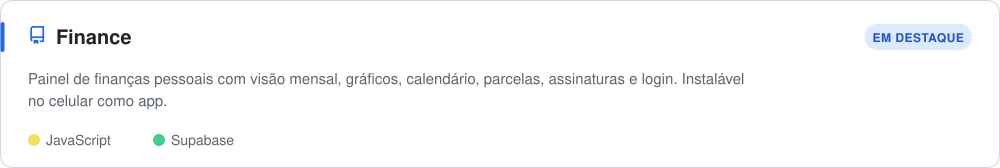
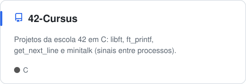
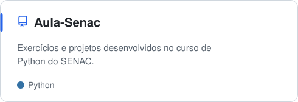
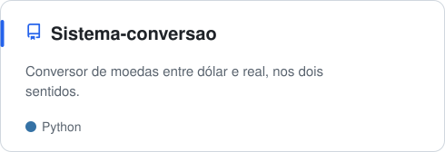
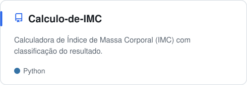

  

  
  
  

  

## 👨‍💻 Sobre mim

Sou estudante de programação com foco em desenvolvimento **Full-Stack**. No back-end, trabalho com **Python**; no front-end, com **HTML**, **CSS**, **JavaScript** e **Bootstrap**; e para dados, uso **SQL** e **MySQL**.

Aprendo construindo projetos práticos e também estudo **C** e **C#** para reforçar a base em lógica e estruturas de dados.

- 🚀 Atualmente desenvolvendo o [**Finance**](https://github.com/dudux64/Finance), um painel de finanças pessoais
- 🎯 Aberto a estágio e vagas de desenvolvedor júnior
- 📍 Rio de Janeiro, Brasil

## 🛠️ Tecnologias

  

## 📂 Projetos em destaque

  

  
  

  
  

## 📊 Linguagens mais usadas

  

